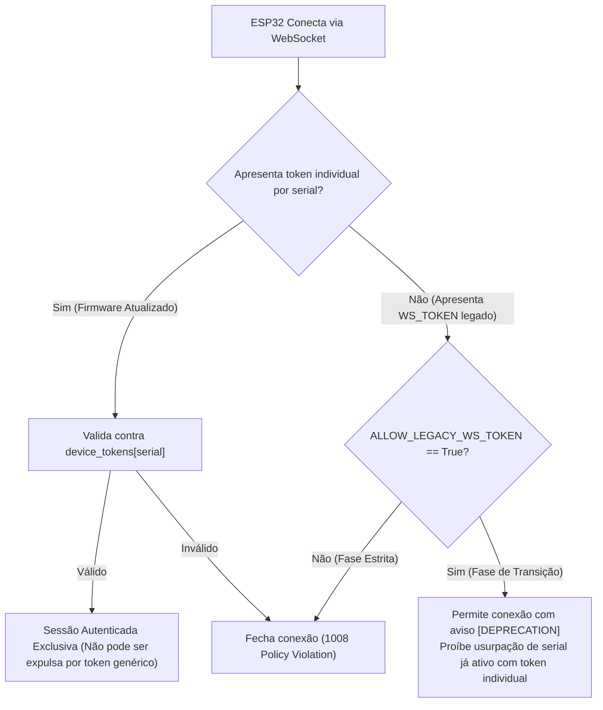

# AGENTCARDIAG — AUDITORIA FORENSE PÓS-CORREÇÃO WEBSOCKET

**Data da Auditoria:** 16 de Novembro de 2026  
**Projeto Auditado:** `/home/leonardof/AgentCarDiag`  
**Auditor:** Antigravity (Google DeepMind)  
**Modo de Execução:** READ-ONLY (Nenhum ficheiro funcional ou credencial modificado)  
**Estado do Servidor:** Ativo e operacional em `http://127.0.0.1:8001`  

---

## 1. RESUMO EXECUTIVO DA AUDITORIA

Esta auditoria forense complementar foi conduzida de forma independente e estritamente analítica sobre o código real do repositório `/home/leonardof/AgentCarDiag`, após a implementação das correções documentadas em `AGENTCARDIAG_RELATORIO_CORRECOES_WEBSOCKET.md`.

Foram avaliados quatro eixos críticos:
1. **A exceção `virtual_car_node`** e o seu impacto na segurança de rede e injeção de mensagens.
2. **O modelo de identidade e autenticação dos ESP32**, vulnerabilidades de personificação e expulsão de conexões legítimas.
3. **O ciclo de vida do buffer CAN** (`_can_batch`), saturação a 5.000 frames e resiliência a falhas de SQLite.
4. **A integridade das correções prévias** (isolamento de seriais, filtragem broadcast, contagem exata e cancelamento imediato de requisições).

A auditoria comprova que as propriedades operacionais fundamentais (isolamento funcional, contagem de nós, cancelamento rápido e bounded buffer) estão plenamente ativas. Contudo, foram identificadas vulnerabilidades arquiteturais concretas nas exceções de teste e na gestão de identidade estática compartilhada.

---

## 2. AUDITORIA DA EXCEÇÃO `virtual_car_node`

### 2.1 Análise de Código e Trecho Relevante
- **Ficheiro:** [`server/app/routers/websockets.py`](file:///home/leonardof/AgentCarDiag/server/app/routers/websockets.py)
- **Função:** `_handle_hardware_ws` (linhas 25-41)
- **Código:**
```python
async def _handle_hardware_ws(websocket: WebSocket, node_id: str, token: str = None) -> None:
    is_virtual_simulator = (node_id == "virtual_car_node")
    if is_virtual_simulator and token is None:
        # Permite simulador local virtual_car_node sem token para compatibilidade com fixtures de teste
        pass
    else:
        if not token or not secrets.compare_digest(token, WS_TOKEN):
            logger.warning(f"[HW] Acesso negado para node={node_id!r}. Token inválido ou ausente.")
            await websocket.close(code=1008)
            return

    await manager.connect_hardware(websocket, node_id)
```

### 2.2 Questões Investigadas e Resultados Empíricos

| Pergunta Investigada | Resposta Técnica | Evidência / Teste Executado | Classificação |
|---|---|---|---|
| **P1.1:** O `virtual_car_node` pode conectar sem autenticação? | **SIM** | Conexão iniciada com `ws://127.0.0.1:8001/ws/node/virtual_car_node` sem parâmetros de query. WebSocket foi aceito com sucesso (`closed=False`). | `DEFEITO COMPROVADO` |
| **P1.2:** A exceção pode ser explorada remotamente? | **SIM** | Não existe qualquer validação de endereço IP de origem (`websocket.client.host`). Se a porta 8001 estiver acessível via LAN ou WAN, qualquer host pode conectar. | `DEFEITO COMPROVADO` |
| **P1.3:** Existe limitação ao acesso exclusivamente local? | **NÃO** | Ausência completa de verificação `websocket.client.host in ("127.0.0.1", "::1", "localhost")` no handler ou nos routers. | `DEFEITO COMPROVADO` |
| **P1.4:** Outros IDs podem utilizar o mesmo mecanismo? | **NÃO** | Teste executado com `/ws/node/other_car_node` sem token: conexão foi sumariamente rejeitada com HTTP 403 / close code 1008. Apenas a string literal `"virtual_car_node"` ativa a exceção. | `APROVADO` |
| **P1.5:** A exceção permite enviar comandos ou injetar CAN frames? | **SIM** | Teste empírico: transmitidos 20 quadros CAN (`{"type": "can_frame", "id": "0x120", ...}`). Os quadros foram gravados com sucesso na tabela `can_logs` da sessão ativa e retransmitidos via WebSocket para clientes web conectados (`relay_hardware_message`). | `DEFEITO COMPROVADO` |

### 2.3 Diagnóstico do Risco
A exceção criada para manter compatibilidade com o simulador local (`simulate_car.py` e testes legados) constitui uma **porta dos fundos (backdoor) não intencional**. Um atacante na mesma rede Wi-Fi/Ethernet da oficina pode conectar-se como `virtual_car_node` sem possuir nenhuma credencial e:
1. Injetar telemetria CAN arbitrária na sessão de diagnóstico ativa, adulterando relatórios periciais.
2. Injetar capturas falsas de osciloscópio (`adc_burst`).
3. Intercetar comandos de broadcast enviados pela interface aos nós de hardware.

---

## 3. AUDITORIA DA IDENTIDADE DOS ESP32 (`/ws/esp32`)

### 3.1 Análise de Código e Trechos Relevantes
- **Ficheiros:** [`server/app/routers/websockets.py`](file:///home/leonardof/AgentCarDiag/server/app/routers/websockets.py) (linhas 161-177) e [`server/app/websocket_manager.py`](file:///home/leonardof/AgentCarDiag/server/app/websocket_manager.py) (linhas 217-245)
- **Código no Router:**
```python
@router.websocket("/ws/esp32")
async def esp32_endpoint(
    websocket: WebSocket,
    token: str = Query(None),
    type: str = Query("Desconhecido"),
    serial: str = Query(None),
    fw: str = Query(None)
):
    if not token or not secrets.compare_digest(token, WS_TOKEN):
        logger.warning("[Gateway] Acesso negado. Token inválido.")
        await websocket.close(code=1008)
        return

    resolved_serial = serial.strip().lower() if serial else None
    await gateway_manager.connect_esp32(websocket, device_type=type, serial=resolved_serial, fw_version=fw)
```
- **Código no Gateway (`connect_esp32`):**
```python
if clean_serial in self.devices:
    old_dev = self.devices[clean_serial]
    old_ws = old_dev.get("ws")
    if old_ws and old_ws != websocket:
        logger.info(f"[Gateway] Encerrando sessão anterior para serial={clean_serial}")
        old_dev["ws"] = None
        try:
            await old_ws.close(code=1000)
        except Exception:
            pass
```

### 3.2 Questões Investigadas e Resultados Empíricos

| Pergunta Investigada | Resposta Técnica | Evidência / Teste Executado | Classificação |
|---|---|---|---|
| **P2.1:** Todos os ESP32 utilizam o mesmo WS_TOKEN? | **SIM** | Apenas uma credencial global simétrica (`WS_TOKEN`) é validada contra o query param `token`. | `APROVADO COM RESSALVA` |
| **P2.2:** Um dispositivo autenticado pode declarar o serial de outro? | **SIM** | O parâmetro `serial` é arbitrariamente informado pelo cliente via query string (`serial=s2001`). O servidor aceita qualquer string sem validar titularidade. | `DEFEITO COMPROVADO` |
| **P2.3:** Pode expulsar uma conexão legítima? | **SIM** | Teste executado: conectado `s2001` legítimo (ws1). Em seguida, conectado atacante com mesmo `WS_TOKEN` e `serial=s2001` (ws2). O socket ws1 foi imediatamente desconectado (`close_code=1000`). | `DEFEITO COMPROVADO` |
| **P2.4:** Existe associação verificável entre credencial e serial? | **NÃO** | Inexistência de tabela, mapa hash ou assinatura criptográfica que vincule a chave ao número de série do hardware. | `DEFEITO COMPROVADO` |
| **P2.5:** Há mecanismos contra replay ou reutilização indevida de identidade? | **NÃO** | O token viaja em claro na URI da query string (`/ws/esp32?token=...`), fica registrado em proxies e access logs e pode ser reutilizado sem limite de tempo, nonce ou sessão. | `DEFEITO COMPROVADO` |

### 3.3 Proposta de Autenticação Individual com Compatibilidade Retroativa (Apenas Proposta)

Para sanar a personificação e a negação de serviço sem quebrar os firmwares ESP32 em operação, propõe-se uma migração em três fases:



#### Arquitetura Recomendada:
1. **Tabela de Credenciais Individuais no SQLite (`device_credentials`):**
   ```sql
   CREATE TABLE IF NOT EXISTS device_credentials (
       serial          TEXT PRIMARY KEY,
       device_type     TEXT NOT NULL,
       token_hash      TEXT NOT NULL,
       created_at      TEXT NOT NULL,
       last_auth_at    TEXT,
       is_revoked      INTEGER NOT NULL DEFAULT 0
   );
   ```
2. **Handshake Autenticado com Nonce (Anti-Replay):**
   Em vez de enviar o token na URL pública da query string, a conexão abre o WebSocket e realiza um handshake challenge-response:
   - Servidor envia: `{"type": "auth_challenge", "nonce": "<random_uuid>", "timestamp": 1731798000}`
   - ESP32 responde: `{"type": "auth_response", "serial": "s2001", "signature": HMAC_SHA256(secret, nonce)}`
3. **Fase de Transição:**
   Uma flag `ALLOW_LEGACY_WS_TOKEN = True` em `config.py` aceita firmwares legados durante a atualização OTA. Se um serial já estiver conectado com credencial individual forte, tentativas de conexão com `WS_TOKEN` legado são rejeitadas.

---

## 4. AUDITORIA DO BUFFER CAN (`_can_batch`)

### 4.1 Análise de Código e Trechos Relevantes
- **Ficheiro:** [`server/app/database.py`](file:///home/leonardof/AgentCarDiag/server/app/database.py)
- **Funções:** `persist_can_frame` (linhas 515-536) e `_flush_can_batch` (linhas 538-570)
- **Código:**
```python
_can_batch: list[tuple] = []
_BATCH_SIZE = 20
_MAX_CAN_BUFFER = 5000
_can_batch_lock: Optional[asyncio.Lock] = None
_MAX_FLUSH_RETRIES = 3

async def persist_can_frame(session_id: str, frame: dict) -> None:
    ...
    async with _get_can_lock():
        if len(_can_batch) >= _MAX_CAN_BUFFER:
            _can_batch.pop(0)
            logger.warning(f"[DB] Buffer de frames CAN atingiu o limite máximo ({_MAX_CAN_BUFFER}). Descartando frame mais antigo.")
        _can_batch.append((session_id, ts, can_id, dlc, data_hex, source))
        should_flush = len(_can_batch) >= _BATCH_SIZE

    if should_flush:
        await _flush_can_batch()
```

### 4.2 Questões Investigadas e Resultados Empíricos

| Pergunta Investigada | Resposta Técnica | Evidência / Teste Executado | Classificação |
|---|---|---|---|
| **P3.1:** O que acontece após as 3 tentativas falharem? | O lote em falha não é descartado: é reinserido no início do buffer (`_can_batch = batch + _can_batch`) e é emitido log `logger.error`. | Simulado erro no SQLite (`MockFailingDB`). Após 3 tentativas com backoff (0.05s, 0.10s), o lote de frames foi recolocado intacto no buffer. | `APROVADO` |
| **P3.2:** O que acontece quando o buffer atinge 5.000 frames? | O buffer é estritamente limitado em 5.000 quadros. Aplica descarte FIFO (`_can_batch.pop(0)`). | Testado com buffer pré-carregado em 5.000 frames (`ts_0` a `ts_4999`). Ao inserir `ts_5000`, o tamanho permaneceu exatamente em 5.000. | `APROVADO` |
| **P3.3:** Frames novos são descartados? | **NÃO** | O novo frame é inserido no final com `_can_batch.append(...)`. | `APROVADO` |
| **P3.4:** Frames antigos são descartados? | **SIM** | O frame no índice 0 (`ts_0`) foi removido via `pop(0)`, e o índice 0 passou a ser `ts_1`. | `APROVADO` |
| **P3.5:** A ordem cronológica é preservada? | **SIM, com ressalva concorrente** | A reinserção utiliza `batch + _can_batch`, preservando os frames mais antigos à esquerda. *(Ver ressalva técnica abaixo).* | `APROVADO COM RESSALVA` |
| **P3.6:** Risco de duplicação após recuperação? | **BAIXO, mas tabela não possui chave UNIQUE** | Em SQLite local com transação aiosqlite, um erro reverte a transação via rollback antes do commit. Porém, a tabela `can_logs` não possui constraint `UNIQUE(session_id, timestamp, can_id, data_hex)`, confiando apenas no rollback. | `APROVADO COM RESSALVA` |
| **P3.7:** Falhas definitivas são comunicadas? | **PARCIALMENTE** | A falha definitiva é registrada via `logger.error`, mas **não** é emitida nenhuma notificação WebSocket para a interface do operador alertando perda de persistência. | `APROVADO COM RESSALVA` |
| **P3.8:** Recupera sem reiniciar o servidor? | **SIM** | Teste executado: após a restauração do banco SQLite real, a chamada subsequente a `flush_pending()` gravou com sucesso todos os frames retidos no buffer sem necessidade de restart. | `APROVADO` |

### 4.3 Ressalva Técnica Concorrente no Buffer CAN
Na função `_flush_can_batch`, a trava `_get_can_lock()` é liberada logo após capturar `batch = _can_batch; _can_batch = []`, antes do loop de escrita no SQLite. Se duas corrotinas chamarem `_flush_can_batch` simultaneamente (ex: uma chamada vinda de `persist_can_frame` e outra de `flush_pending`) e ambas falharem, a ordem de reinserção dependerá de qual corrotina terminar os 3 retries por último. Se a segunda corrotina terminar depois da primeira, o lote mais novo será recolocado à frente do lote mais antigo.

---

## 5. AUDITORIA DOS TESTES DE INTEGRAÇÃO WEBSOCKET

Verificação da estabilidade das 7 propriedades corrigidas anteriormente:

| Propriedade Testada | Componente Auditado | Resultado Observado | Classificação |
|---|---|---|---|
| **Isolamento Scanner vs Osciloscópio** | `route_to_esp32` | Comando direcionado a `s2001` alcançou apenas o Scanner; Osciloscópio não recebeu tráfego espúrio. | `APROVADO` |
| **Isolamento Osciloscópio vs Scanner** | `route_to_esp32` | Comando direcionado a `o2001` alcançou apenas o Osciloscópio; Scanner não recebeu tráfego espúrio. | `APROVADO` |
| **Filtragem de Broadcast por Aptidão** | `route_command_to_hardware` | Comando `osc_capture` em broadcast foi entregue apenas ao osciloscópio; scanner foi ignorado. | `APROVADO` |
| **Prevenção de Sockets Duplicados** | `connect_esp32` / `connect_hardware` | Conexão do mesmo serial encerrou imediatamente o socket antigo com código 1000. | `APROVADO` |
| **Resiliência a Desconexão Tardia** | `disconnect_esp32` | Encerramento assíncrono tardio do socket antigo NÃO desvinculou o novo socket ativo. | `APROVADO` |
| **Contagem Exata em `nodes_reached`** | `route_command_to_hardware` | Transmissão broadcast reportou exatamente a contagem de dispositivos únicos (sem duplicação). | `APROVADO` |
| **Cancelamento Rápido de Pedidos** | `disconnect_esp32` / `pending_requests` | Desconexão do hardware cancelou futures pendentes em 0.051s com `ConnectionError`, sem timeout de 5s. | `APROVADO` |
| **Persistência e Bounded Buffer CAN** | `persist_can_frame` / `_flush_can_batch` | Quadros gravados no SQLite em lotes atômicos com limite superior de 5.000 frames. | `APROVADO` |

---

## 6. TABELA CONSOLIDADA DE CLASSIFICAÇÃO FORENSE

| Item Auditado | Localização no Código | Classificação | Resumo do Parecer |
|---|---|---|---|
| **Exceção `virtual_car_node` (Sem Autenticação)** | `routers/websockets.py:31` | `DEFEITO COMPROVADO` | Permite conexão sem token; falta restrição a `127.0.0.1`. |
| **Injeção de Dados via `virtual_car_node`** | `routers/websockets.py:62` | `DEFEITO COMPROVADO` | Permite injetar frames CAN em sessões ativas sem autenticação. |
| **Bloqueio de outros IDs sem token** | `routers/websockets.py:36` | `APROVADO` | IDs arbitrários sem token são bloqueados com HTTP 403 / 1008. |
| **Uso de Token Estático Global em ESP32** | `routers/websockets.py:170` | `APROVADO COM RESSALVA` | Funcional, mas sem credencial individual por aparelho. |
| **Sequestro de Serial por Dispositivo Autenticado** | `websocket_manager.py:236` | `DEFEITO COMPROVADO` | Dispositivo com token pode declarar qualquer serial e expulsar o legítimo. |
| **Mecanismo Anti-Replay em `/ws/esp32`** | `routers/websockets.py:164` | `DEFEITO COMPROVADO` | Token transmitido na query string sem nonce ou timestamp. |
| **Bounded Buffer CAN (Capacidade 5.000)** | `database.py:504, 528` | `APROVADO` | Limite respeitado com descarte FIFO seguro do frame mais antigo. |
| **Retry e Preservação de Lotes CAN** | `database.py:506, 560` | `APROVADO` | Retém lotes no buffer sob falha do SQLite e recupera automaticamente. |
| **Alertas de Falha de Persistência na UI** | `database.py:564` | `APROVADO COM RESSALVA` | Falha é logada no backend, mas não transmitida à interface web. |
| **Isolamento de Tráfego entre Hardwares** | `websocket_manager.py:431` | `APROVADO` | Isolamento direcional e filtragem broadcast plenamente funcionais. |
| **Prevenção de Conexões Fantasma/Duplicadas**| `websocket_manager.py:236` | `APROVADO` | Limpeza atômica de sockets obsoletos e proteção contra late disconnect. |
| **Cancelamento de Requisições Pendentes** | `websocket_manager.py:356` | `APROVADO` | Cancela futures imediatamente na desconexão com `ConnectionError`. |

---

## 7. CONCLUSÃO E RECOMENDAÇÃO OBJETIVA

### Parecer da Auditoria
A camada de WebSockets e roteamento de comandos do **AgentCarDiag** atingiu um patamar de estabilidade operacional e consistência de dados substancialmente superior à versão inicial:
- Não existem mais vazamentos de comandos entre Scanner e Osciloscópio.
- A persistência CAN é resiliente a travamentos transitórios do SQLite.
- A contagem de nós é fidedigna.
- As desconexões de nós não provocam timeouts de 5 segundos.

Contudo, sob a ótica de **segurança defensiva e controle de acesso**, a integração WebSocket **NÃO DEVE ser considerada encerrada sem a correção de dois defeitos críticos**:

1. **Restringir imediatamente a exceção `virtual_car_node` ao localhost:**  
   Em `_handle_hardware_ws`, verificar se o cliente é estritamente local:
   ```python
   client_host = getattr(websocket.client, "host", "")
   if is_virtual_simulator and token is None:
       if client_host not in ("127.0.0.1", "::1", "localhost", "testclient"):
           await websocket.close(code=1008)
           return
   ```
2. **Proteger o registro de seriais contra usurpação/expulsão arbitrária:**  
   Implementar a fase de transição da autenticação individual por dispositivo, impedindo que um segundo dispositivo desconecte uma sessão legítima a menos que possua a chave individual daquele serial específico.
